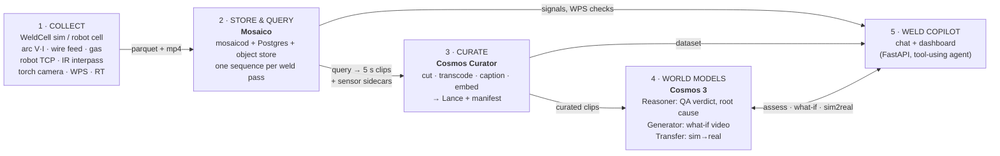

# WeldWorld: Physical AI for Fabrication Welding

**A working prototype of the full physical-AI loop for a pipe-spool and pressure-vessel weld shop. The sensors on a
robotic weld cell feed a robotics data platform. A video-curation pipeline turns that data into training clips.
NVIDIA Cosmos 3 world models then *judge, explain, imagine and multiply* the welds, and a chat copilot sits on top
that a QA manager can actually use.**

Built on open-source infrastructure: **[Mosaico](https://github.com/mosaico-labs/mosaico)** (robotics data platform),
**[NVIDIA Cosmos Curator](https://github.com/nvidia-cosmos/cosmos-curator)** (video curation) and
**[NVIDIA Cosmos 3](https://github.com/NVIDIA/cosmos)** (Reasoner and Generator world models). It runs on a laptop
(CPU, replay mode) or on a RunPod GPU pod.

> **Data notice.** By default the demo runs on **real, public welding data** (both CC BY 4.0, attribution shown in the
> app and on the dataset card). The WeldCell **simulator** is still available (`DATA_SOURCE=sim`); its passes are tagged
> `source.synthetic: true` and use fictitious IDs such as `SP-1043`. No customer data is included. See
> [docs/REAL_DATA.md](docs/REAL_DATA.md) for the full data contract.

### Data

| `source.id` | dataset (CC BY 4.0) | what the demo uses | passes |
|---|---|---|---|
| `aimen_saw` | Tapia Suárez E. A., Pérez Couñago I., Eike Precker C., Fernández Montenegro J. M., Ruiz C. (AIMEN) — *Submerged Arc Welding Open Repository* (PENELOPE, H2020 GA 958303). Zenodo, [DOI 10.5281/zenodo.15083865](https://doi.org/10.5281/zenodo.15083865) | two-wire tandem SAW on 52 mm SA-516 Gr.70N coupons PP3–PP7: lead + trail current/voltage/wire feed, pyrometers, torch position, **post-weld bead photos**, **RT/UT indications** (porosity, lack of fusion) with position. No video. | `PP5_B02_SAW` |
| `bam_tgmaw` | Chaurasia P. K., Fabry Ç., Pittner A., Rethmeier M. (BAM) — *Tandem-GMAW: advanced pulsed and short-circuiting process mode experimental data*. Zenodo, [DOI 10.5281/zenodo.21824586](https://doi.org/10.5281/zenodo.21824586) | tandem GMAW layers on 30 mm S355J2+N: lead + trail electrical signals, gas flow, thermocouples, robot TCP, **HDR grayscale process-camera video** (BAM overlay kept) + its Canny edge map for Cosmos Transfer. Not NDT-inspected (`rt_result: not_inspected`). | `WID617_L3_TGMAW` |

`DATA_SOURCE=real|sim|all` (default `real`) selects the collect stage: `real` runs
`python -m collect.datasets.fetch` (`REAL_SOURCES`, `AIMEN_COUPONS` (default all PP3–PP7), `BAM_WIDS` (laptop
default `617,630`, pod default `all`)), downloading into `DATA_DIR/raw/` (default `DATA_DIR=data/real`; AIMEN's
12.7 GB zip is read remotely with HTTP range requests). Each pass becomes one Mosaico sequence; streams a dataset
lacks are simply absent (SAW has no gas: `gas_lpm` is NaN; AIMEN has no video, so its NDT windows are exported as
photo items with the bead photo; BAM has no NDT). The "WPS" ranges are the published nominal settings ±10 % — a
demo assumption, not a qualified WPS. Real defects do not necessarily show in the electrical signals (the AIMEN
porosity windows have the same mean current and voltage as clean weld), and the pipeline says so ("no electrical
signature") instead of inventing one. `make fixture-real` writes a tiny contract-compliant fixture (one SAW + one
tandem GMAW pass) for offline smoke runs.


<!-- screenshots: docs/img/copilot_dashboard.png, copilot_chat_rootcause.png, whatif_video.png, sim2real.png,
     mosaico_query.png, curated_dataset.png (produced by the data and app builds) -->

---

## What it does

| You ask the copilot… | What happens under the hood |
|---|---|
| *"Which welds this week broke the WPS?"* | Mosaico query over per-pass sequences and their metadata (process, WPS, spool, RT result) |
| *"Find passes where travel speed went above 7 mm/s"* | **Query by physics**: Mosaico searches inside the 100 Hz sensor streams, not just file names |
| *"Why did SP-1043 J07 fill pass fail RT?"* | WPS-limit check on the synced signals, then the **Cosmos 3 Reasoner** watches the torch-camera clip with sensor context and returns verdict, defect, root cause and action. The replay jumps to the defect |
| *"What if travel speed dropped 20% on that pass?"* | **Cosmos 3 Generator** renders a counterfactual video of the same pass |
| *"Make photoreal training video from the simulator"* | **Cosmos 3 Transfer**: the simulator's edge/depth control video becomes photoreal weld footage (sim→real) |
| *"How many curated clips do we have for porosity?"* | **Cosmos Curator** output: 5-second clips, quality-filtered, captioned, embedded and labelled with sensor stats and RT |

## Architecture



| Stage | Component | License | Role in the demo |
|---|---|---|---|
| 1 Collect | `collect/` WeldCell simulator (+ optional public dataset adapters) | this repo | physically consistent arc, robot and thermal streams, torch-cam render, edge/depth control video, injected defects, RT labels |
| 2 Store & query | **Mosaico** `mosaicod` + `mosaicolabs` SDK | Apache-2.0 | typed time-series and video per pass, metadata and value queries, synced extraction |
| 3 Curate | **NVIDIA Cosmos Curator** (Curator Next recipes), or `curate-lite` on CPU | Apache-2.0 | clip cutting, transcode, captioning (Qwen3.8 / Cosmos 3), Cosmos-Embed1 embeddings, Lance table |
| 4 World models | **NVIDIA Cosmos 3** Nano (Reasoner via vLLM, Generator/Transfer via vLLM-Omni) | NVIDIA OpenMDW-1.1 (model weights) | weld QA verdicts, root cause and WPS findings; what-if and sim→real video |
| 5 Copilot | `copilot/` FastAPI + web UI; chat via Claude tool use, the Cosmos Reasoner or a scripted router | this repo | the screen the customer sees |

More detail is in [docs/ARCHITECTURE.md](docs/ARCHITECTURE.md): data flow, interfaces, GPU memory layout and ports.

---

## Quickstart A: laptop, CPU only (replay mode)

Needs Python 3.10+ and `make`. Docker is optional and adds a real Mosaico server. [uv](https://docs.astral.sh/uv/) is used if present.

```bash
git clone <this-repo-url> weldworld && cd weldworld
make demo-local          # venv → fetch real data → (Mosaico if Docker) → export → curate-lite → copilot
# open http://localhost:7860
```

`make demo-local` uses `COSMOS_BACKEND=replay`: world-model answers come from the cache in `data/cache/worldmodels`,
which a GPU run populates. Without Docker it runs Mosaico in **offline mode**, reading `data/real/generated/` directly with
the same API. To show the UI with no pipeline run at all, use `make copilot-fixtures`.

Step by step:

```bash
make setup-local                 # .venv + requirements.txt, creates .env from configs/demo.env.example
make infra-up                    # Postgres + mosaicod + MinIO (infra/docker-compose.yml)
make collect                     # real data → data/real/generated/<PP5_B02_SAW|WID617_L3_TGMAW>/ (AIMEN_COUPONS=PP5 BAM_WIDS=617 for a quick run)
make simulate                    # or: the WeldCell simulator → data/generated/<SP-1043_J07_P3_FCAW>/ (DATA_SOURCE=sim)
make ingest                      # → Mosaico sequences (+ /camera/bead/photo, /camera/torch/image when present)
make export                      # → data/real/export/<clip>.mp4|photos/ + .json
make curate                      # BACKEND=lite (default) | curator-next | curator-legacy
make copilot                     # http://localhost:7860
make test
```

Optional keys go in `.env`: `ANTHROPIC_API_KEY` (Claude as the chat agent) and `NVIDIA_API_KEY` (hosted Cosmos 3 on
build.nvidia.com via `COSMOS_BACKEND=nim`, with no local GPU).

**Windows / no `make`:** `python scripts/run_copilot.py` starts the copilot in replay mode (loads `.env`, opens the
browser). It runs uvicorn through Python, so it also works where an Application Control policy blocks pip's
`uvicorn.exe`. Use `--fixtures` for built-in mock data, or `python runpod/download.py demo` first for the GPU run's data.

## Quickstart B: one command on Runpod (from your laptop)

```bash
cp .env.example .env          # fill in RUNPOD_API_KEY, HF_TOKEN, ANTHROPIC_API_KEY, GITHUB_TOKEN
python3 runpod/launch.py      # or: make cloud-run   (make cloud-serve keeps the copilot up for the meeting)
```

`runpod/launch.py` uses only the Python standard library. It:

1. creates (or reuses) a **150 GB network volume** in the data center with the best stock for `GPU_TYPE`
2. creates the **GPU pod** (default 2× H100 80GB, CUDA 13 host) with the volume at `/workspace` and your keys as env vars
3. the pod clones this repo and runs `runpod/pod_entry.sh`: bootstrap → Mosaico → fetch real data (all BAM workpieces)/ingest/export →
   Cosmos Curator → Cosmos 3 servers → warm cache → results in `/workspace/results/` (on the volume)
4. streams the pod logs to your terminal and **terminates the pod when the code ends** — on success, on failure,
   on Ctrl-C, or after `MAX_HOURS`. The pod also terminates itself, so nothing keeps billing if your laptop sleeps.

The volume is kept (models + venvs + results, about $10.50/month) so the next run starts in minutes;
`python3 runpod/launch.py down --delete-volume` (or `DELETE_VOLUME_AT_END=1`) removes it.
Download results to your computer (no pod needed; uses the volume's S3 API, needs `pip install boto3` and an
S3 API key in `.env`): `python runpod/download.py` (summaries and logs) or `python runpod/download.py demo`
(also the Cosmos results cache, curated clips and simulated passes, so the copilot runs locally in replay mode).
`status`, `logs`, `down` and `availability` (which data centers have GPUs right now) are the other commands.
If the volume's data center is sold out: `--wait 30` keeps retrying for 30 minutes, `--move-volume` recreates the
volume where GPUs are free (its cached weights are re-downloaded). All settings are documented in `.env.example`.

## Quickstart C: manual setup on a Runpod pod (live Cosmos 3 + Curator)

Recommended: **2× H100 80GB** (about $8/hr Secure Cloud) with a **150 GB network volume** at `/workspace`, CUDA 13
host (driver ≥ 580). Budget: 1× H100 (Reasoner + FP8 Generator with offload).

```bash
# on the pod (image runpod/pytorch:2.1.0-cu1300-torch2130-ubuntu2404; HTTP ports 7860,9001; TCP 22,6726)
cd /workspace && git clone <this-repo-url> weld-physical-ai-demo && cd weld-physical-ai-demo
bash runpod/bootstrap.sh        # once per volume: Postgres, MinIO, mosaicod, Curator (pixi), Cosmos 3 weights, vLLM
make demo-runpod                # pipeline on GPU → model servers → warm cache → copilot
bash runpod/status.sh           # prints https://<podid>-7860.proxy.runpod.net
```

The full guide, covering template choice, the driver/CUDA matrix, GPU costs, volume sizing, ports, secrets and gotchas,
is in **[runpod/README.md](runpod/README.md)**.

## The demo

The 15-minute talk track, with clicks, chat prompts, "wow" moments, Q&A, a fallback plan and the pilot proposal, is in
**[docs/DEMO_SCRIPT.md](docs/DEMO_SCRIPT.md)**.

| | |
|---|---|
|  |  |
| *Why did J07 fail RT? WPS findings + Cosmos verdict* | *What if travel speed drops 20%?* |
|  |  |
| *Sim→real with Cosmos 3 Transfer* | *Query by physics in Mosaico* |

---

## Repository layout

| Path | Contents |
|---|---|
| `collect/` | shared data contract (`schema.py`), WeldCell simulator, renderer, dataset adapters |
| `mosaico_io/` | Mosaico ontology, `ingest`, `query`, `export` (online and offline) |
| `infra/` | `docker-compose.yml` for local Postgres + mosaicod + MinIO |
| `curate/` | Cosmos Curator configs/runner (`curator-next`, `curator-legacy`) and the CPU `lite` backend |
| `worldmodels/` | Cosmos 3 Reasoner / Generator / Transfer clients, `local`/`nim`/`replay` backends, `serve/` scripts |
| `copilot/` | FastAPI app, tool-using agent, dashboard |
| `runpod/` | `launch.py` (one-command run from your laptop), `pod_entry.sh`, `bootstrap.sh`, `start_all.sh`, `stop_all.sh`, `status.sh`, deployment guide |
| `scripts/run_pipeline.py` | end-to-end runner: collect → ingest → export → curate → warm-cache, with timing and offline/replay flags |
| `configs/demo.env.example` | every configuration variable, documented |
| `docs/` | `PLAN.md`, `ARCHITECTURE.md`, `DEMO_SCRIPT.md`, `research/` notes |

## Licenses and third-party components

This repository's code is the demo glue. It **does not vendor** the components below. Each one is installed from its
upstream source under its own license.

| Component | License | Notes |
|---|---|---|
| [Mosaico](https://github.com/mosaico-labs/mosaico) (`mosaicod`, `mosaicolabs` SDK) | Apache-2.0 | daemon binary from GitHub releases / `ghcr.io/mosaico-labs/mosaicod` |
| [NVIDIA Cosmos Curator](https://github.com/nvidia-cosmos/cosmos-curator) | Apache-2.0 | the models it downloads (Qwen3.8-27B-FP8 captioner, TransNetV2, Cosmos-Embed1) carry their own licenses; see its `MODEL_CARDS.md` |
| [NVIDIA Cosmos 3](https://huggingface.co/nvidia/Cosmos3-Nano) model weights | NVIDIA OpenMDW-1.1 | commercial use permitted under the agreement's terms |
| [cosmos-framework](https://github.com/NVIDIA/cosmos-framework) / vLLM / vLLM-Omni | Apache-2.0 | serving stack |
| MinIO (community edition, built from source) | AGPL-3.0 | used unmodified as a local S3 endpoint for Curator; swap for any S3-compatible store |
| PostgreSQL | PostgreSQL License | Mosaico catalog |

**Guardrails.** Cosmos ships a safety guardrail model (`nvidia/Cosmos-1.0-Guardrail`) that is **gated** on Hugging
Face. This demo runs the Generator **with guardrails disabled** (`COSMOS_GUARDRAILS=0`, the default) because it only
generates industrial weld footage from synthetic inputs. Turn them on for any production or user-facing deployment
(request access, then set `COSMOS_GUARDRAILS=1`), and review NVIDIA's responsible-use terms.

**Not an inspection system.** WeldWorld is a prototype for decision support. It does not replace code-required
examination (RT/UT/VT) or the judgement of a Certified Welding Inspector, and nothing it produces is a code acceptance
decision.
