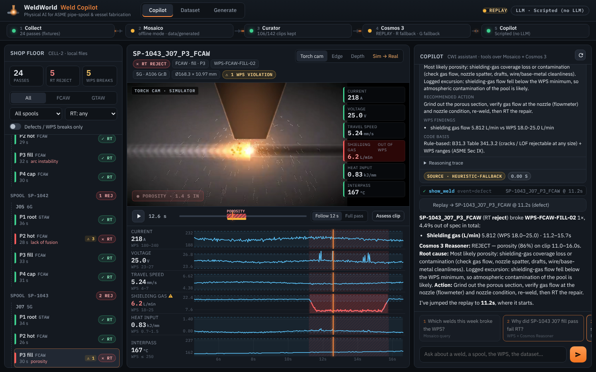

# Weld Copilot

The front door of the WeldWorld demo: a single-page dashboard plus a tool-using chat agent over the whole
physical-AI stack (Collect → Mosaico → Cosmos Curator → Cosmos 3 → Copilot).



## Run

```bash
. .venv/bin/activate

# Real pipeline data (data/generated, data/curated; mosaicod if reachable, otherwise offline files)
uvicorn copilot.app:app --host 0.0.0.0 --port 7860

# Self-contained: generates 24 contract-shaped mock passes (+ videos, manifest) into data/fixtures on first start
COPILOT_FIXTURES=1 uvicorn copilot.app:app --port 7860
```

Open http://localhost:7860. Click the numbered chips under the chat for the 5-minute demo flow:

| # | Prompt | What happens |
|---|---|---|
| 1 | Which welds this week broke the WPS? | `list_passes(only_wps_violations, since_days=7)` → table card, rows open the replay |
| 2 | Why did SP-1043 J07 fill pass fail RT? | `wps_check` → `assess_weld` (Cosmos 3 Reasoner verdict card) → `show_weld` jumps the replay |
| 3 | Show me the moment porosity started | replay seeks to the defect onset (HUD + plots turn red) |
| 4 | What if travel speed dropped 20% on that pass? | `what_if` → background Cosmos 3 Generator job, progress card → side-by-side video |
| 5 | Make photoreal training video from the simulator | `sim2real` → Cosmos 3 Transfer job; **Sim → Real** toggle shows it next to the control video |
| 6 | How many curated clips do we have for porosity? | `dataset_stats` + `search_clips` over the Curator manifest |

## Chat backends (`COPILOT_LLM`)

| Value | Backend |
|---|---|
| `claude` (default when `ANTHROPIC_API_KEY` is set) | Anthropic Messages API, streaming manual tool loop. Model `COPILOT_MODEL` (default `claude-opus-5-5`), adaptive thinking (summaries streamed into the chat), effort `COPILOT_EFFORT` (default `medium`), `eager_input_streaming` tools with input validation, server-side refusal fallback (`fallbacks: "default"`) on models that support it. |
| `cosmos` | Cosmos 3 Reasoner via its OpenAI-compatible endpoint `COSMOS_REASONER_URL` (model `COSMOS_REASONER_MODEL`). Uses native function calling; if the vLLM server has no tool parser it switches to a ReAct-style JSON protocol (`COPILOT_COSMOS_TOOLS=auto|native|react`). |
| `scripted` (default with no key) | No LLM: keyword/intent router over the same tools with templated narration. Deterministic, zero keys. |

Tools (`copilot/tools.py`, shared by all backends): `list_passes`, `find_anomalies`, `get_signals_summary`,
`wps_check`, `show_weld`, `assess_weld`, `what_if`, `sim2real`, `dataset_stats`, `search_clips`.
Each returns a compact JSON result for the LLM plus UI cards (table, chart, verdict, job, stats, clips) and
UI actions (`show_weld` moves the replay).

## How it talks to the other modules

All imports are optional; the app degrades instead of failing.

- **`mosaico_io`** (`copilot/data.py`): `list_passes()`, `get_signals(seq)`, `wps_violations(seq)` per PLAN.md.
  If the module is missing or a call raises, it reads `DATA_DIR/generated/<seq>/` directly (same files as the
  offline mode). `COPILOT_DATA=local` forces the file reader. The local WPS check uses 0.5 s moving averages
  (1 s for travel speed / heat input, to remove weave), a 1 % deadband and ignores the arc-start/stop transients.
- **Curator** (`DATA_DIR/curated/manifest.jsonl`, `dataset_card.md`): Dataset tab, `dataset_stats`, `search_clips`.
- **`worldmodels`** (`copilot/models.py`): `reason.assess_clip(video, context)` gets a 5 s clip (manifest clip, or
  cut from `torch_cam.mp4` with ffmpeg) and an export-sidecar-shaped context. `generate.what_if_meta` /
  `transfer.sim2real_meta` are used when present (for `source`, `latency_ms`, `placeholder`), else the plain
  functions. Backend mode (LIVE GPU / NIM / REPLAY) comes from `worldmodels.config.resolve_backend`.
  Without worldmodels, or when it only returns a placeholder video, the copilot renders a clearly labelled
  `copilot-mock` (heuristic verdict / ffmpeg-filtered clip). `COPILOT_MOCK_PLACEHOLDERS=0` keeps the placeholders.

## API

| Endpoint | |
|---|---|
| `GET /api/health` | pipeline strip: per-stage status + backend mode + LLM |
| `GET /api/passes?process=&spool_id=&has_defect=&rt_result=` | pass rows (+ violation counts) |
| `GET /api/passes/{seq}` | meta, WPS limits, violations, events, defect windows, media URLs, latest sim2real |
| `GET /api/passes/{seq}/signals?hz=25` | downsampled synced signals for the replay plots |
| `GET /api/dataset?defect=&kept=&q=` | manifest rows + stats + dataset card |
| `POST /api/chat` `{message, session_id}` | SSE stream: `text`, `thinking`, `tool_start`, `tool_end`, `card`, `ui`, `done`, `error` |
| `POST /api/tools/{name}` | call a tool directly |
| `POST /api/generate` `{kind: what_if\|sim2real, sequence, change, control, t, seed, prompt}` | start a job |
| `GET /api/jobs/{id}/events` | SSE job progress; `GET /api/gallery` lists finished renders |
| `GET /files/...` | media under `DATA_DIR` (sandboxed, media types only, HTTP range for video seeking) |

## Files

- `app.py` FastAPI app · `agent.py` chat backends · `tools.py` tool specs + implementations
- `data.py` data access/fallbacks/health · `models.py` worldmodels adapter + mocks · `jobs.py` background jobs
- `fixtures.py` mock data generator (`python -m copilot.fixtures --out data/fixtures [--no-video]`)
- `static/` UI (vanilla JS; uPlot 1.6.30, marked 12.0.2, DOMPurify 3.1.6 vendored in `static/vendor/`, no build step)
- `scripts/screenshots.cjs` Playwright screenshots → `docs/img/copilot_*.png`

## Tests

```bash
pytest tests/test_copilot_api.py tests/test_copilot_agent.py -q
```
API endpoints on fixture data, scripted intent routing, the Claude tool loop with a mocked client, and the
Cosmos ReAct protocol with a mocked OpenAI client. No network or keys needed.

## Env reference

`DATA_DIR` (default `./data`), `COPILOT_FIXTURES`, `COPILOT_DATA=auto|local|mosaico_io`, `COPILOT_LLM`,
`COPILOT_MODEL`, `COPILOT_EFFORT`, `ANTHROPIC_API_KEY`, `COSMOS_REASONER_URL`, `COSMOS_REASONER_MODEL`,
`COPILOT_COSMOS_TOOLS`, `COSMOS_BACKEND` (read by worldmodels), `MOSAICO_HOST`/`MOSAICO_PORT`/`MOSAICO_OFFLINE`,
`COPILOT_MOCK_PLACEHOLDERS`, `COPILOT_MOCK_DELAY` (mock latency, s), `COPILOT_SCRIPT_DELAY` (scripted typing speed).
