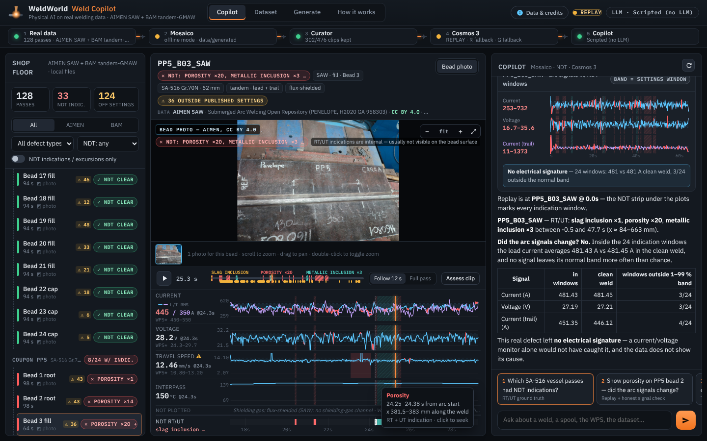
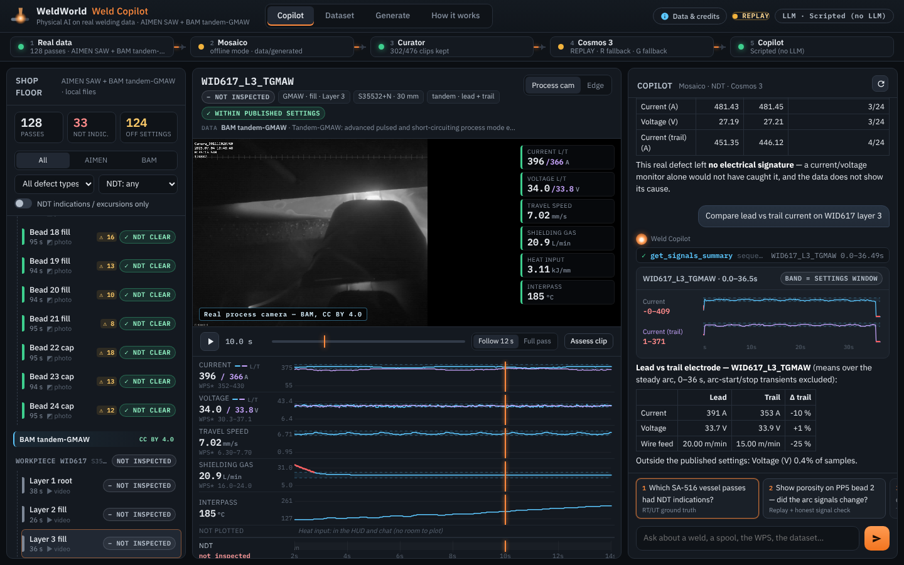
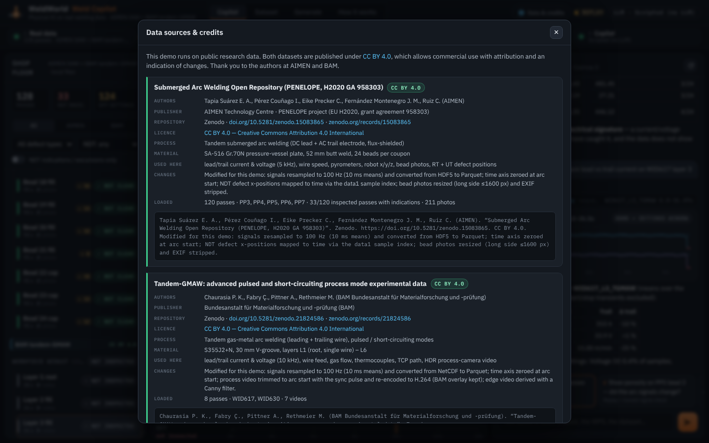
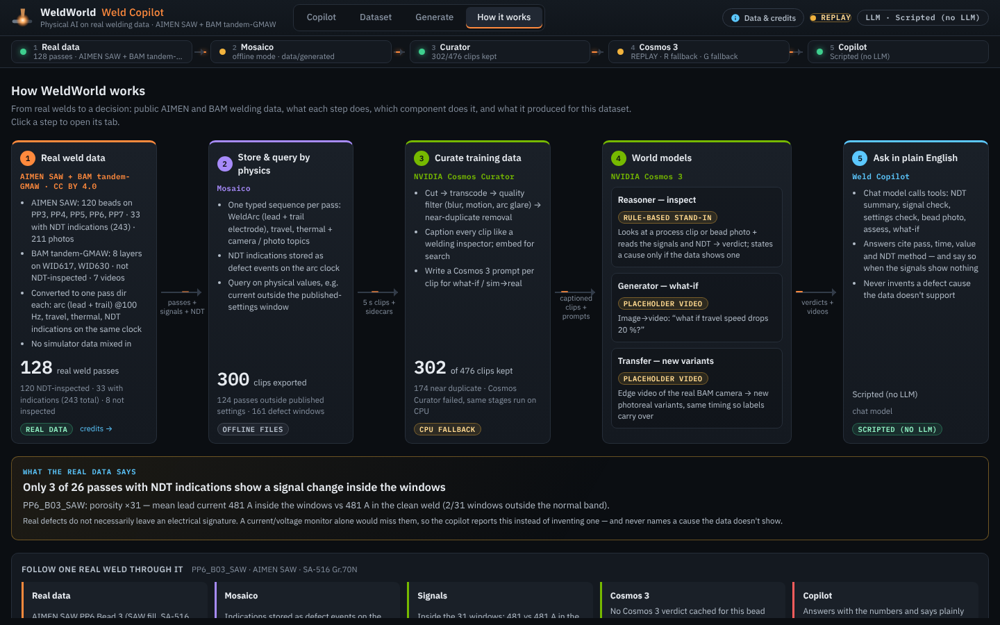
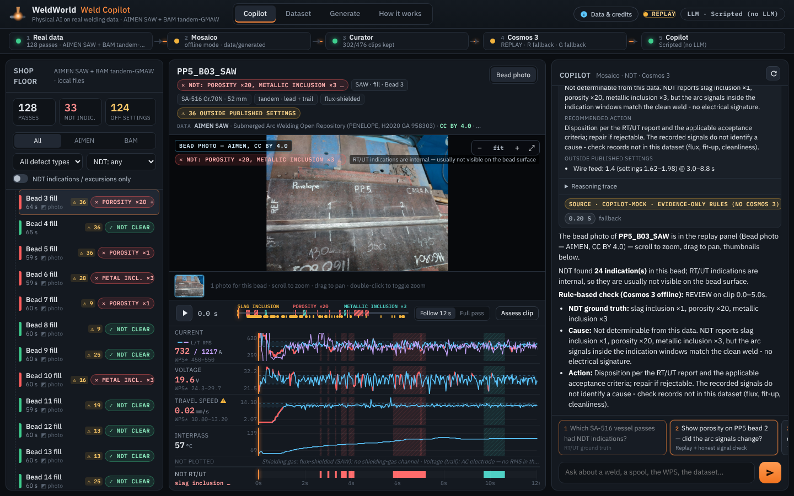

# Weld Copilot

The front door of the WeldWorld demo: a single-page dashboard plus a tool-using chat agent over the whole
physical-AI stack (Collect → Mosaico → Cosmos Curator → Cosmos 3 → Copilot).


## Run

```bash
. .venv/bin/activate

# Real pipeline data (data/generated, data/curated; mosaicod if reachable, otherwise offline files)
uvicorn copilot.app:app --host 0.0.0.0 --port 7860

# Self-contained: generates 24 contract-shaped mock passes (+ videos, manifest) into data/fixtures on first start
COPILOT_FIXTURES=1 uvicorn copilot.app:app --port 7860

# Real-data contract stand-ins (AIMEN SAW beads with placeholder photo + NDT, BAM layers with a grey clip):
COPILOT_FIXTURES=real uvicorn copilot.app:app --port 7860       # writes data/fixtures_real on first start
```

Open http://localhost:7860. Click the numbered chips under the chat for the 5-minute demo flow:

| # | Prompt | What happens |
|---|---|---|
| 1 | Which welds this week broke the WPS? | `list_passes(only_wps_violations, since_days=7)` → table card, rows open the replay |
| 2 | Why did SP-1043 J07 fill pass fail RT? | `wps_check` → `assess_weld` (Cosmos 3 Reasoner verdict card) → `show_weld` jumps the replay |
| 3 | Show me the moment porosity started | replay seeks to the defect onset (HUD + plots turn red) |
| 4 | What if travel speed dropped 20% on that pass? | `what_if` → background Cosmos 3 Generator job, progress card → side-by-side video |
| 5 | Make photoreal training video from the simulator | `sim2real` → Cosmos 3 Transfer job; **Sim → Real** toggle shows it next to the control video |
| 6 | How many curated clips do we have for porosity? | `dataset_stats` + `search_clips` over the Curator manifest |

## Real data (default)

`DATA_SOURCE=real|sim|all` (default `real`, see [docs/REAL_DATA.md](../docs/REAL_DATA.md)). With no `DATA_DIR`, the
copilot serves `data/real/` when it holds passes, else `data/` (simulator); `all` lists both side by side.
Everything is driven by the pass dirs themselves (`meta.source.synthetic`), so wording switches automatically.



- **Shop floor**: source → coupon / workpiece → pass. NDT badges: `indications` red (`porosity ×14`),
  `no_indications` green (*NDT clear*), `not_inspected` grey, legacy RT accept/reject. Filters by dataset, defect type
  and NDT result; simulator passes carry a **SIMULATED** tag.
- **Replay**: real BAM process video (caption *Real process camera — BAM, CC BY 4.0*), bead-photo viewer for AIMEN
  beads (thumbnails, wheel zoom, drag, double-click), and an **NDT strip** under the plots with every indication window
  in its type colour (hover: type, time, x mm, method; click: seek). The playhead works without video (virtual clock).
- **Signals**: only channels that exist are plotted; tandem passes overlay lead (blue) and trail (violet). AC electrodes
  (AIMEN trail) show `current2_rms_a` when present; an AC channel without RMS is not plotted or checked (10 ms means of AC
  are meaningless). SAW shows *flux-shielded: no shielding-gas channel*. Settings bands come from `meta.wps` only, with
  `meta.wps_basis` as tooltip (*published nominal ±10 %, not a qualified WPS*). Real passes skip 3 s / 1.5 s of arc-start /
  arc-stop transients in checks (simulator: 1 s / 0.6 s).
- **Provenance**: the pass header shows dataset, licence and DOI; **Data & credits** (top bar) lists both datasets with
  authors, title, Zenodo DOI, CC BY 4.0 and the changes made (CC BY attribution). `/api/sources` serves the same.
- **Honesty**: `DataLayer.indication_check(seq)` compares the arc signals inside the NDT windows with the clean weld
  (mean, and how many windows fall outside the 1–99 % band of same-length rolling means). `ndt_summary`, the How-it-works
  finding and the rule-based assessor report *no electrical signature* when that is what the data shows, and never name a
  cause. On real data a worldmodels `heuristic-fallback` verdict is replaced by an evidence-only rule check.
- **How it works**: step 1 is *Real weld data* (both datasets with counts), plus the computed finding and a real weld
  followed end to end.

Demo chips (resolved against the loaded passes, e.g. the photo chip moves to the nearest bead that has a photo):
*Which SA-516 vessel passes had NDT indications?* · *Show porosity on PP5 bead 2 — did the arc signals change?* ·
*Compare lead vs trail current on WID617 layer 3* · *Which passes ran outside their published settings?* ·
*Inspect the bead photo of PP5 bead 3* · *What if travel speed dropped 20 % on WID630 layer 4?*
References like `PP5 B02`, `PP5 bead 2`, `WID617 L3`, `WID617 layer 3`, or `layer 2` (same workpiece) resolve.

|  |  |
|---|---|
|  |  |

## Chat backends (`COPILOT_LLM`)

| Value | Backend |
|---|---|
| `claude` (default when `ANTHROPIC_API_KEY` is set) | Anthropic Messages API, streaming manual tool loop. Model `COPILOT_MODEL` (default `claude-opus-5-5`), adaptive thinking (summaries streamed into the chat), effort `COPILOT_EFFORT` (default `medium`), `eager_input_streaming` tools with input validation, server-side refusal fallback (`fallbacks: "default"`) on models that support it. |
| `cosmos` | Cosmos 3 Reasoner via its OpenAI-compatible endpoint `COSMOS_REASONER_URL` (model `COSMOS_REASONER_MODEL`). Uses native function calling; if the vLLM server has no tool parser it switches to a ReAct-style JSON protocol (`COPILOT_COSMOS_TOOLS=auto|native|react`). |
| `scripted` (default with no key) | No LLM: keyword/intent router over the same tools with templated narration. Deterministic, zero keys. |

Tools (`copilot/tools.py`, shared by all backends): `list_passes`, `find_anomalies`, `get_signals_summary`,
`wps_check`, `show_weld`, `show_photo`, `ndt_summary`, `assess_weld`, `what_if`, `sim2real`, `dataset_stats`,
`search_clips`. The system prompt switches to a real-data prompt that forbids inventing defect causes and requires
saying so when the signals show no anomaly. `assess_weld` on photo-only passes sends the bead photo to
`worldmodels.reason.assess_clip` (an `image_path`/`image`/`images` keyword if it has one, else the .jpg path).
Each returns a compact JSON result for the LLM plus UI cards (table, chart, verdict, job, stats, clips) and
UI actions (`show_weld` moves the replay).

## How it talks to the other modules

All imports are optional; the app degrades instead of failing.

- **`mosaico_io`** (`copilot/data.py`): `list_passes()`, `get_signals(seq)`, `wps_violations(seq)` per PLAN.md.
  If the module is missing or a call raises, it reads `DATA_DIR/generated/<seq>/` directly (same files as the
  offline mode). `COPILOT_DATA=local` forces the file reader. The local WPS check uses 0.5 s moving averages
  (1 s for travel speed / heat input, to remove weave), a 1 % deadband and ignores the arc-start/stop transients.
- **Curator** (`DATA_DIR/curated/manifest.jsonl`, `dataset_card.md`): Dataset tab, `dataset_stats`, `search_clips`.
- **`worldmodels`** (`copilot/models.py`): `reason.assess_clip(video, context)` gets a 5 s clip (manifest clip, or
  cut from `torch_cam.mp4` with ffmpeg) and an export-sidecar-shaped context. `generate.what_if_meta` /
  `transfer.sim2real_meta` are used when present (for `source`, `latency_ms`, `placeholder`), else the plain
  functions. Backend mode (LIVE GPU / NIM / REPLAY) comes from `worldmodels.config.resolve_backend`.
  Without worldmodels, or when it only returns a placeholder video, the copilot renders a clearly labelled
  `copilot-mock` (heuristic verdict / ffmpeg-filtered clip). `COPILOT_MOCK_PLACEHOLDERS=0` keeps the placeholders.

## API

| Endpoint | |
|---|---|
| `GET /api/health` | pipeline strip: per-stage status + backend mode + LLM |
| `GET /api/passes?process=&spool_id=&has_defect=&rt_result=` | pass rows (+ violation counts) |
| `GET /api/passes/{seq}` | meta, WPS limits, violations, events, defect windows, media URLs, latest sim2real |
| `GET /api/passes/{seq}/signals?hz=25` | downsampled synced signals for the replay plots |
| `GET /api/dataset?defect=&kept=&q=` | manifest rows + stats + dataset card |
| `POST /api/chat` `{message, session_id}` | SSE stream: `text`, `thinking`, `tool_start`, `tool_end`, `card`, `ui`, `done`, `error` |
| `POST /api/tools/{name}` | call a tool directly |
| `POST /api/generate` `{kind: what_if\|sim2real, sequence, change, control, t, seed, prompt}` | start a job |
| `GET /api/jobs/{id}/events` | SSE job progress; `GET /api/gallery` lists finished renders |
| `GET /files/...` | media under `DATA_DIR` (sandboxed, media types only, HTTP range for video seeking) |

## Files

- `app.py` FastAPI app · `agent.py` chat backends · `tools.py` tool specs + implementations
- `data.py` data access/fallbacks/health · `models.py` worldmodels adapter + mocks · `jobs.py` background jobs
- `fixtures.py` mock data generator (`python -m copilot.fixtures --out data/fixtures [--no-video]`)
- `fixtures_real.py` real-contract stand-ins (`python -m copilot.fixtures_real --out data/fixtures_real [--with-sim]`)
- `provenance.py` dataset registry + CC BY attribution · `flow.py` numbers for the How-it-works tab
- `static/` UI (vanilla JS; uPlot 1.6.30, marked 12.0.2, DOMPurify 3.1.6 vendored in `static/vendor/`, no build step)
- `scripts/screenshots.cjs` Playwright screenshots → `docs/img/copilot_*.png`;
  `scripts/screenshots_real.cjs` → `docs/img/real_*.png`

## Tests

```bash
pytest tests/test_copilot*.py -q      # simulator fixtures + real-data contract fixtures (test_copilot_real.py)
```
API endpoints on fixture data, scripted intent routing, the Claude tool loop with a mocked client, and the
Cosmos ReAct protocol with a mocked OpenAI client. No network or keys needed.

## Env reference

`DATA_DIR` (default `./data/real` if it has passes, else `./data`), `DATA_SOURCE=real|sim|all`,
`COPILOT_FIXTURES=1|real`, `COPILOT_DATA=auto|local|mosaico_io`, `COPILOT_LLM`,
`COPILOT_MODEL`, `COPILOT_EFFORT`, `ANTHROPIC_API_KEY`, `COSMOS_REASONER_URL`, `COSMOS_REASONER_MODEL`,
`COPILOT_COSMOS_TOOLS`, `COSMOS_BACKEND` (read by worldmodels), `MOSAICO_HOST`/`MOSAICO_PORT`/`MOSAICO_OFFLINE`,
`COPILOT_MOCK_PLACEHOLDERS`, `COPILOT_MOCK_DELAY` (mock latency, s), `COPILOT_SCRIPT_DELAY` (scripted typing speed).
