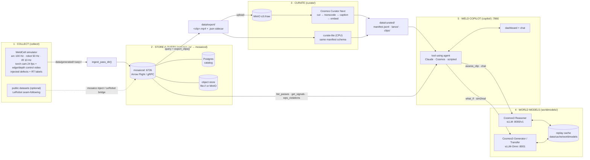

# WeldWorld architecture

This document covers how data moves, the interfaces between packages, where each process runs, which GPU memory it uses and which port it listens on.
The shared contract (names, units, rates) is `collect/schema.py`. The package APIs are listed in `docs/PLAN.md`.

## 1. Data flow



**Offline mode.** Every `mosaico_io` function also works with `MOSAICO_OFFLINE=1`, reading `data/generated/` directly.
`scripts/run_pipeline.py` switches to this automatically when mosaicod is unreachable, unless you pass `--strict`. So the full
demo runs on a laptop with no services and no GPU (`COSMOS_BACKEND=replay`).

## 2. Stages, CLIs and artifacts

| # | Stage | CLI (via `scripts/run_pipeline.py` / `make`) | Reads | Writes |
|---|---|---|---|---|
| 1 | collect | `python -m collect.simulate --out data/generated --n-passes 24 --seed 7` | — | `data/generated/<seq>/{meta.json, arc,travel,robot,thermal .parquet, events.jsonl, torch_cam.mp4, control/{edge,depth}.mp4}` |
| 2 | ingest | `python -m mosaico_io.ingest data/generated` | generated | one Mosaico sequence per pass. Topics `/weld/arc`, `/weld/travel`, `/weld/thermal`, `/robot/joint_states`, `/robot/tcp_pose`, `/camera/torch/image`, `/weld/events` |
| 3 | export | `python -m mosaico_io.export --out data/export` | Mosaico (or generated) | `<clip_id>.mp4` + `.json` sidecar `{clip_id, sequence_name, t0_s, t1_s, meta, signal_stats, wps_violations, defects_in_window, rt_result}` |
| 4 | curate | `python -m curate.run --input data/export --out data/curated --backend {lite,curator-next,curator-legacy}` | export | `manifest.jsonl`, `lance/`, `clips/`, `dataset_card.md` |
| 5 | warm-cache | `python -m worldmodels.cli warm-cache --manifest data/curated/manifest.jsonl --limit 12 --preset live` | manifest | `data/cache/worldmodels/<sha256>.json/.mp4` |
| — | copilot | `uvicorn copilot.app:app --port 7860` | all of the above | `data/copilot/` (generated videos, jobs) |

## 3. Interfaces

| Interface | Protocol | Contract |
|---|---|---|
| Mosaico | Arrow Flight over gRPC, `MOSAICO_HOST:MOSAICO_PORT` (6726) | `mosaicolabs` SDK 0.8. Typed ontologies (custom `WeldArc` / `WeldTravel` or Floating64). Sequence user metadata = flattened `meta.json` |
| mosaicod ↔ Postgres | libpq, `MOSAICOD_DB_URL` + `MOSAICOD_DB_USER/PASSWORD` | migrations applied automatically at start |
| mosaicod ↔ store | `MOSAICOD_STORE_ENDPOINT` (`file:///…` or S3 URL) + `MOSAICOD_STORE_BUCKET` | Parquet chunks |
| Curator Next ↔ MinIO | S3 (`~/.aws/credentials` with `endpoint_url`, region) | `video-cut` accepts **only** `s3://` input |
| Curator ↔ weights | filesystem `/config/models/<model_id>` | on RunPod `/config` → `/workspace/curator_workspace` |
| Reasoner | OpenAI-compatible `POST /v1/chat/completions` (video via `--allowed-local-media-path /`), `GET /v1/models` | `worldmodels.reason.assess_clip / chat` |
| Generator | vLLM-Omni `POST /v1/videos/sync` (multipart: prompt, size, num_frames, fps, steps, guidance, optional `input_reference`) | `worldmodels.generate.what_if`, `worldmodels.transfer.sim2real` |
| Hosted fallback | `integrate.api.nvidia.com/v1` (reasoner), `ai.api.nvidia.com/v1/cosmos/...` (generator), `NVIDIA_API_KEY` | `COSMOS_BACKEND=nim` |
| Replay cache | `data/cache/worldmodels/`, key = sha256 of inputs | `local` writes every call, `replay` reads |
| Copilot | HTTP + SSE on :7860. Long jobs (video) run in the background and are polled, because the RunPod proxy cuts requests at 100 s | `copilot/` |
| Chat LLM | Anthropic Messages tool use (`ANTHROPIC_API_KEY`) / Cosmos Reasoner / scripted router | `COPILOT_LLM` |

**Backend selection** (`worldmodels/config.py`): `COSMOS_BACKEND=auto` probes `…/v1/models` on the local servers, then
uses `nim` if `NVIDIA_API_KEY` is set, otherwise `replay`. It is resolved per service, so the Reasoner can be live while the Generator replays.

## 4. Deployment topologies

| | Laptop / CI | RunPod 1× H100 | RunPod 2× H100 (recommended) |
|---|---|---|---|
| Postgres, mosaicod, MinIO | `infra/docker-compose.yml`, or none (offline) | native (`runpod/start_all.sh infra`) | native |
| Curation | `lite` (CPU) | Curator Next, run **before** the model servers | Curator Next on GPU0, next to the Reasoner |
| Reasoner | replay / nim | GPU0, 0.32 of memory | GPU0, 0.45 of memory |
| Generator | replay / nim | GPU0, FP8 + layer-wise offload | GPU1, BF16 |
| Copilot | `make copilot` | `start_all.sh copilot` | same |

Processes on the pod run detached (`nohup setsid`). PIDs go to `/workspace/run/*.pid` and logs to `/workspace/logs/*.log`.
`runpod/status.sh` checks the health of every service.

## 5. GPU memory layout

Figures from `docs/research/cosmos3.md` (GiB, Cosmos3-Nano): Generator BF16 58 (Transfer 64) · FP8 44 (50) ·
FP8 + offload 32 (38) · Reasoner 23. FP8 needs Hopper or Ada.

```
2× H100 80GB                                   1× H100 80GB
GPU0 ┌──────────────────────────────┐          GPU0 ┌──────────────────────────────┐
     │ Reasoner vLLM   ~36 GB (0.45)│               │ Reasoner vLLM   ~26 GB (0.32)│
     │  weights 23 + KV cache       │               │  weights 23 + KV cache       │
     │ Curator captioner (batch)    │               │ Generator FP8+offload ~32-38 │
     │  Qwen3.8-27B-FP8 ~30-40 GB   │               │  (layers streamed from host) │
     └──────────────────────────────┘               │ headroom ~10 GB              │
GPU1 ┌──────────────────────────────┐               └──────────────────────────────┘
     │ Generator BF16  ~58 GB       │          Curator: run first, then
     │ Transfer        ~64 GB       │          `start_all.sh models`
     │ headroom        ~16 GB       │
     └──────────────────────────────┘
```

Overrides (names read by `worldmodels/serve/{reasoner,generator}.sh`): `REASONER_GPU`, `REASONER_GPU_UTIL`,
`GENERATOR_GPU`, `GENERATOR_PRECISION` (`bf16|fp8|fp8-ckpt`) and `OFFLOAD` (`0|1`). `start_all.sh` sets them from the GPU
count and runs the scripts in the foreground under its own process supervisor. On a shared GPU it waits for the Reasoner
to finish loading before it starts the Generator.

## 6. Ports

| Port | Service | Bind | RunPod exposure |
|---|---|---|---|
| 7860 | Weld Copilot | 0.0.0.0 | HTTP proxy `https://<pod>-7860.proxy.runpod.net` |
| 9001 | MinIO console | 0.0.0.0 | HTTP proxy `-9001` |
| 6726 | mosaicod | 0.0.0.0 (`MOSAICOD_BIND`) | TCP (public IP, random external port), or an SSH tunnel |
| 9000 | MinIO S3 API | 0.0.0.0 | internal |
| 8000 | Cosmos3 Reasoner (vLLM) | per serve script | internal |
| 8001 | Cosmos3 Generator (vLLM-Omni) | per serve script | internal |
| 5432 | Postgres | localhost | internal |
| 22 | SSH | — | TCP |

## 7. Persistence on RunPod (`/workspace` network volume)

```
/workspace/
├── weld-physical-ai-demo/      repo + .venv + data/ (generated, export, curated, cache)
├── .cache/huggingface/         Cosmos3-Nano weights (HF cache shared by bootstrap + vLLM)
├── cosmos-curator/             checkout + .pixi env (pixi install --frozen -e default)
├── curator_workspace/models/   Curator weights (/config → here)
├── cosmos/                     venv-reasoner (vLLM), venv-omni (vLLM-Omni), optional cosmos-framework
├── pgdata/  minio-data/  mosaico-store/
├── bin/                        uv, mosaicod, minio, crane
├── .weldworld/                 env.sh (paths), demo.env (edit me), secrets.env (generated), aws/, cosmos_curator/
├── logs/  run/
└── .cache/                     uv, pixi, go build caches
```

The container disk (apt packages, `/config` symlink, `~/.aws` symlinks) is wiped on restart.
`start_all.sh` re-runs `bootstrap.sh --apt-only` when it finds the packages missing.
